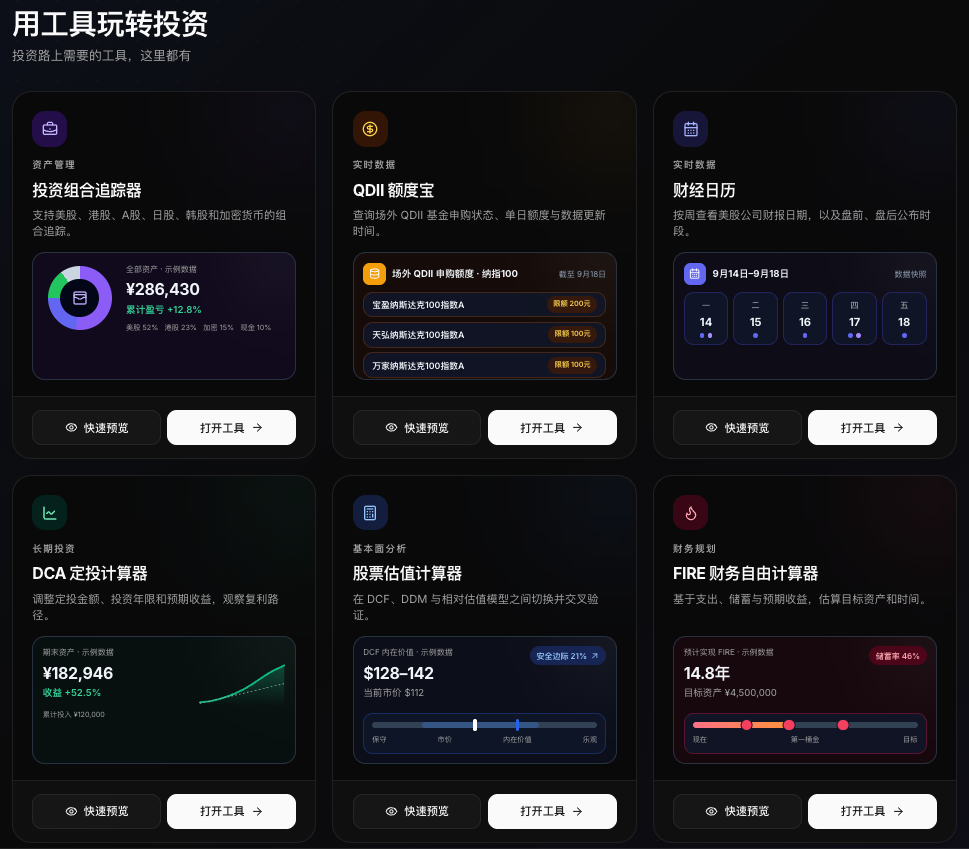

<p align="center">
  
</p>

<h1 align="center">Nico 投资指南</h1>

<p align="center"><strong>Nico’s Investment Guide</strong></p>

<p align="center"><strong>面向大陆用户的美股与加密货币投资入门指南</strong></p>

<p align="center">
  <a href="https://invest-nav.com/"></a>
  <a href="https://www.youtube.com/@NicoGrowthz"></a>
  <a href="https://x.com/tychozzz"></a>
</p>

<p align="center">
  <a href="#guides">教程导航</a> ·
  <a href="#latest">最近更新</a> ·
  <a href="#tools">用工具</a> ·
  <a href="#videos">看视频</a> ·
  <a href="#about">关于作者</a>
</p>

## 📈 Nico 投资指南：从 0 到 1 入门美股与加密投资

疫情之后美股 AI 牛市启动，三四年时间过去，标普纳指已经从低点翻倍，无数 AI 相关的股票涨了几倍甚至是 10 倍以上。在此期间，也有无数新手小白涌入美股，想要从中分一杯羹…

然而对于大陆用户来说，投资美股，并不是如投资 A 股一般简单，中间隔着非常多障碍。

比如说如何开通境外银行账户、如何跨境汇款、如何开通美股券商账户、如何完成出入金，等等一系列问题。

很多人在刚开始入门的时候，总是一头雾水，不知道从哪一步开始。市面上的各类教程也良莠不齐，割韭菜居多，一些朋友还没有开始投资，就被骗子掏空了腰包，得不偿失，只能黯然离场…

今天我结合自己过去几年的实操经验，整理出一套全网最详细最全面的专门面向大陆用户的投资指南。

涵盖香港银行开户、美股投资、加密货币投资、出入金资金流转等所有常见的主题。

涵盖你在投资入门过程中，所有需要提前想清楚的理念、提前准备的工具、提前注意的事项。

让你不仅知道“怎么做”，还要知道“为什么这么做”，帮助你真正从 0 到 1 入门。

你可以按照主题阅读，也可以直接全局搜索当前需要解决的问题。

如果你喜欢网站阅读，可以前往 [投资导航](https://invest-nav.com/)；喜欢跟着视频学习，可以看我的 [YouTube 频道](https://www.youtube.com/@NicoGrowthz)。

> GitHub 项目、网站、YouTube 频道持续更新中，欢迎大家持续关注更多干货内容…

> 本项目仅分享个人经验心得，不构成任何投资建议，在具体实操之前，请务必结合自己的实际财务情况。

<a id="guides"></a>

## 教程导航

### 00 · 从这里开始：如何食用「Nico 投资指南」？

[进入](./00-开始阅读/README.md)

### 01 · 美股投资

| 二级分类 | 仓库目录 |
| --- | --- |
| 01 · 香港境外银行 | [进入](./01-美股投资/01-香港境外银行/README.md) |
| 02 · 美股券商 | [进入](./01-美股投资/02-美股券商/README.md) |
| 03 · 美股 QDII 基金 | [进入](./01-美股投资/03-美股QDII基金/README.md) |
| 04 · 美股 ETF | [进入](./01-美股投资/04-美股ETF/README.md) |
| 05 · 美股基础 | [进入](./01-美股投资/05-美股基础/README.md) |
| 06 · 选股与估值方法 | [进入](./01-美股投资/06-选股与估值方法/README.md) |
| 07 · 美债 | [进入](./01-美股投资/07-美债/README.md) |

### 02 · 加密货币

| 二级分类 | 仓库目录 |
| --- | --- |
| 01 · 交易所 | [进入](./02-加密货币/01-交易所/README.md) |
| 02 · 加密货币基础 | [进入](./02-加密货币/02-加密货币基础/README.md) |
| 03 · 加密货币虚拟卡 | [进入](./02-加密货币/03-加密货币虚拟卡/README.md) |
| 04 · Web3 钱包 | [进入](./02-加密货币/04-Web3钱包/README.md) |
| 05 · 交易与理财 | [进入](./02-加密货币/05-交易与理财/README.md) |
| 06 · 币圈空投 | [进入](./02-加密货币/06-币圈空投/README.md) |

### 03 · 出入金 / 资金流转

| 二级分类 | 仓库目录 |
| --- | --- |
| 01 · 出入金 | [进入](./03-出入金与资金流转/01-出入金/README.md) |
| 02 · 海外电话卡 | [进入](./03-出入金与资金流转/02-海外电话卡/README.md) |
| 03 · 海外账号 | [进入](./03-出入金与资金流转/03-海外账号/README.md) |

### 04 · 财富认知

| 二级分类 | 仓库目录 |
| --- | --- |
| 01 · 投资心法 | [进入](./04-财富认知/01-投资心法/README.md) |
| 02 · 资产配置与养老 | [进入](./04-财富认知/02-资产配置与养老/README.md) |
| 03 · 书单分享 | [进入](./04-财富认知/03-书单分享/README.md) |
| 04 · 财富人生 | [进入](./04-财富认知/04-财富人生/README.md) |
| 05 · 时代趋势 | [进入](./04-财富认知/05-时代趋势/README.md) |

### 05 · AI 与效率

| 二级分类 | 仓库目录 |
| --- | --- |
| 01 · AI 实操教程 | [进入](./05-AI与效率/01-AI实操教程/README.md) |
| 02 · AI 观点 | [进入](./05-AI与效率/02-AI观点/README.md) |

<a id="latest"></a>

### 最近更新

每周自动从[投资导航网站](https://invest-nav.com/)同步，下面是最新上线的 10 篇：

<!-- sync:latest:start -->
- 2026-11-09 · [美股账户的钱怎么留给家人？人不在了账户会怎样：美国遗产税 6 万美元免税额、受益人（TOD）怎么设、家人怎么继承](<./01-美股投资/05-美股基础/12-美股账户的钱怎么留给家人？人不在了账户会怎样：美国遗产税 6 万美元免税额、受益人（TOD）怎么设、家人怎么继承.md>)
- 2026-11-09 · [买美股要交哪些税？分红扣 10% 还是 30%、卖出赚钱交不交税、W-8BEN 和 1042-S 税单，以及国内境外所得怎么申报](<./01-美股投资/05-美股基础/11-买美股要交哪些税？分红扣 10% 还是 30%、卖出赚钱交不交税、W-8BEN 和 1042-S 税单，以及国内境外所得怎么申报.md>)
- 2026-11-09 · [富途、老虎、moomoo 大陆还能开户吗？老账户只能卖出了怎么办：卖出出金还是转仓，换到哪家券商](<./01-美股投资/02-美股券商/38-富途、老虎、moomoo 大陆还能开户吗？老账户只能卖出了怎么办：卖出出金还是转仓，换到哪家券商.md>)
- 2026-11-08 · [复星 VS 盈立：大陆身份证能开的港美股券商选哪个？开户、入金出金、手续费、能买的市场和港股打新从 0 到 1 横向对比](<./01-美股投资/02-美股券商/37-复星 VS 盈立：大陆身份证能开的港美股券商选哪个？开户、入金出金、手续费、能买的市场和港股打新从 0 到 1 横向对比.md>)
- 2026-11-08 · [美股券商的钱怎么转回内地？嘉信、盈透、复星、盈立、BIT 出金回国路线对比：到哪张卡、手续费多少、多久到账、占不占外汇额度](<./03-出入金与资金流转/01-出入金/26-美股券商的钱怎么转回内地？嘉信、盈透、复星、盈立、BIT 出金回国路线对比：到哪张卡、手续费多少、多久到账、占不占外汇额度.md>)
- 2026-11-08 · [《小狗钱钱》读书笔记：一本写给孩子的理财书，为什么大人读完更有收获？梦想储蓄罐、金鹅账户、成功日记和 72 小时规则](<./04-财富认知/03-书单分享/13-《小狗钱钱》读书笔记：一本写给孩子的理财书，为什么大人读完更有收获？梦想储蓄罐、金鹅账户、成功日记和 72 小时规则.md>)
- 2026-11-08 · [《投资最重要的事》读书笔记：霍华德·马克斯的第二层次思维、风险、周期和逆向投资，普通人能用上的 6 个道理](<./04-财富认知/03-书单分享/12-《投资最重要的事》读书笔记：霍华德·马克斯的第二层次思维、风险、周期和逆向投资，普通人能用上的 6 个道理.md>)
- 2026-11-08 · [《漫步华尔街》读书笔记：为什么连专业基金经理都很难跑赢指数，普通人买指数基金、按年龄配置资产的理由](./04-财富认知/03-书单分享/11-《漫步华尔街》读书笔记：为什么连专业基金经理都很难跑赢指数，普通人买指数基金、按年龄配置资产的理由.md)
- 2026-11-08 · [盈透 VS 嘉信：美国本土券商选哪个？开户门槛、入金出金、手续费、换汇、交易软件和税务从 0 到 1 横向对比](<./01-美股投资/02-美股券商/36-盈透 VS 嘉信：美国本土券商选哪个？开户门槛、入金出金、手续费、换汇、交易软件和税务从 0 到 1 横向对比.md>)
- 2026-11-08 · [每个年龄该存多少钱？30 岁 1 倍年薪、40 岁 3 倍、50 岁 6 倍，对照全国真实收支，算出你自己的存钱目标](<./04-财富认知/02-资产配置与养老/03-每个年龄该存多少钱？30 岁 1 倍年薪、40 岁 3 倍、50 岁 6 倍，对照全国真实收支，算出你自己的存钱目标.md>)
<!-- sync:latest:end -->

<a id="tools"></a>

## 用工具玩转投资

投资路上需要的工具，这里都有，全部免费，开箱即用，[点击进入投资导航网站](https://invest-nav.com/)。

- [投资组合追踪器](https://invest-nav.com/tools/portfolio-tracker/)：看清持仓、盈亏和资产配置
- [QDII 额度宝](https://invest-nav.com/tools/qdii-quota/)：先确认今天还能买多少
- [财经日历](https://invest-nav.com/tools/earnings-calendar/)：提前安排本周财报研究
- [DCA 定投计算器](https://invest-nav.com/tools/dca-calculator/)：把定投计划换算成长期结果
- [股票估值计算器](https://invest-nav.com/tools/valuation/)：比较市价与内在价值假设
- [FIRE 财务自由计算器](https://invest-nav.com/tools/fire-calculator/)：算出财务自由还需要多久

<a href="https://invest-nav.com/#home-investment-tools">
  
</a>

<a id="videos"></a>

## 看视频学投资

不想看文字教程？直接跟着视频一步步操作。

[YouTube 频道「Nico 投资有道」](https://www.youtube.com/@NicoGrowthz)长期分享开户、出入金以及美股加密投资实操讲解，每周 1-2 更，欢迎持续关注。

<a href="https://www.youtube.com/@NicoGrowthz">
  
</a>

## 仓库结构

```text
invest-guide/
├── README.md
├── LICENSE
├── assets/
├── scripts/                # 从投资导航网站同步教程的脚本
├── 00-开始阅读/
├── 01-美股投资/
│   ├── 01-香港境外银行/
│   ├── 02-美股券商/
│   ├── 03-美股QDII基金/
│   ├── 04-美股ETF/
│   ├── 05-美股基础/
│   ├── 06-选股与估值方法/
│   └── 07-美债/
├── 02-加密货币/
│   ├── 01-交易所/
│   ├── 02-加密货币基础/
│   ├── 03-加密货币虚拟卡/
│   ├── 04-Web3钱包/
│   ├── 05-交易与理财/
│   └── 06-币圈空投/
├── 03-出入金与资金流转/
│   ├── 01-出入金/
│   ├── 02-海外电话卡/
│   └── 03-海外账号/
├── 04-财富认知/
│   ├── 01-投资心法/
│   ├── 02-资产配置与养老/
│   ├── 03-书单分享/
│   ├── 04-财富人生/
│   └── 05-时代趋势/
└── 05-AI与效率/
    ├── 01-AI实操教程/
    └── 02-AI观点/
```

<a id="about"></a>

## 关于作者

大家好，我是 Nico。美股/比特币长期投资者，长期定投可能是普通人财富自由的最简单方式。

持续分享长期投资观念、投资策略、投资心得、跨境投资攻略。

长期关注 [X](https://x.com/tychozzz)、[YouTube](https://www.youtube.com/@NicoGrowthz)、[Telegram](https://t.me/nicoinvestmentfriends)，一起实现财富自由。

## 内容使用说明

本指南仅用于个人经验心得分享，不构成任何投资建议。在具体实操之前，请务必结合自己的实际财务情况、投资目标和风险承受能力，独立判断并谨慎决策。

本指南涉及的平台信息、开户条件、费用及操作流程可能发生变化，请以相关机构的最新官方说明为准，并遵守适用的法律法规。文中提及的平台、产品或服务，不代表对其安全性、可靠性或收益的保证。

投资有风险，可能损失部分或全部本金。本指南不承诺任何投资收益，请充分了解相关风险，并对自己的投资决策和操作负责。

本仓库全部内容按[内容许可协议](./LICENSE)发布，保留所有权利：未经作者事先书面许可，任何单位或个人不得转载、复制、摘编或用于商业用途；经许可转载须注明出处并附原文链接。未经授权的转载、抄袭、洗稿、商用等行为均属侵权，作者保留追究法律责任的权利，**侵权必究**。

如果需要教程转载或者商务合作，请联系我的商务邮箱：[nicoinvestmentzzz@gmail.com](mailto:nicoinvestmentzzz@gmail.com)。
